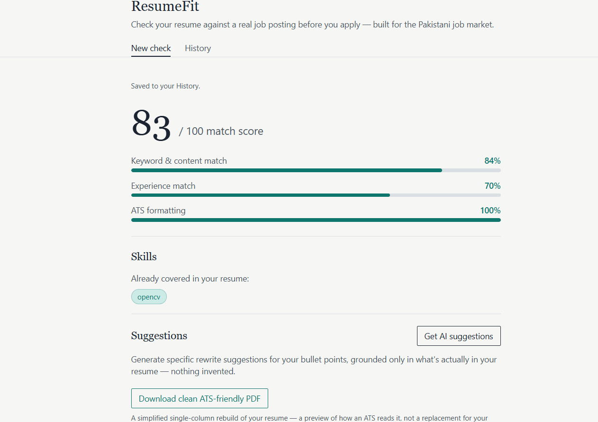
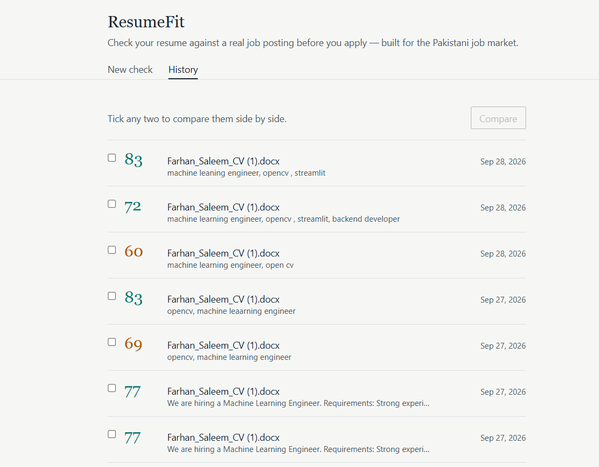
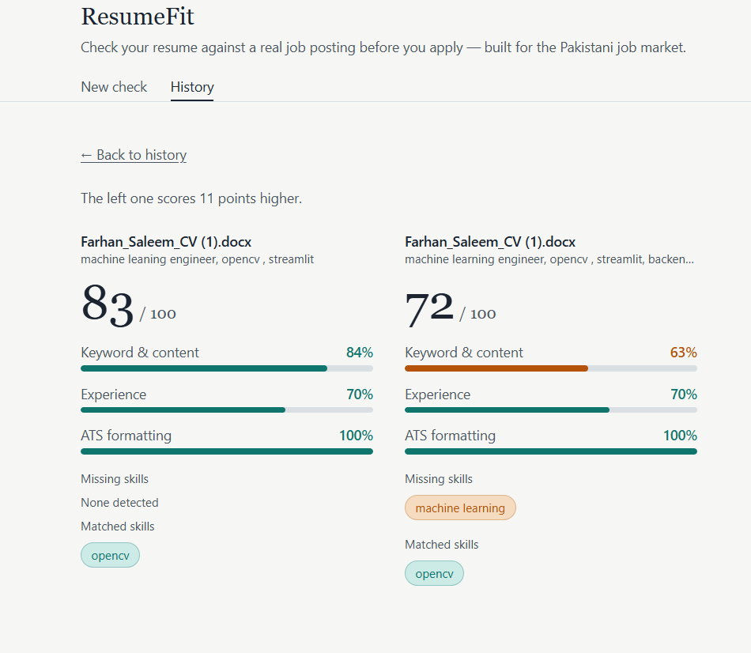
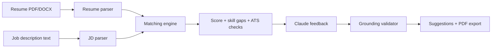

# ResumeFit

**An ATS resume checker for the Pakistani job market.** Upload a resume, paste a real job posting, and get a 0–100 match score, a skill-gap breakdown, ATS formatting warnings, and grounded rewrite suggestions — before you apply.







## The problem

Candidates apply to jobs without knowing whether their resume will pass an Applicant Tracking System filter, and generic checkers give a number with no specific, actionable advice. Most existing tools are also tuned to Western resumes and postings. ResumeFit is built around how resumes are actually written locally — for example, fresh graduates who list **Projects** instead of a formal **Experience** section are handled correctly instead of being penalised.

## Features

- **Resume parsing** — PDF and DOCX into structured data (contact, skills, experience/projects, education).
- **Job description parsing** — required skills, experience level, responsibilities.
- **Match score (0–100)** with a visible breakdown: keyword/content match, experience match, ATS formatting.
- **Semantic matching** — sentence embeddings compare meaning, not just keywords, so keyword-stuffing doesn't inflate the score.
- **Skill-gap analysis** — exactly which required skills are matched and which are missing.
- **ATS formatting checks** — tables, images, and missing standard section headers.
- **AI suggestions (Claude)** — before/after bullet rewrites and missing-skill notes, with fabrication blocked in code (see below).
- **PDF export** — a clean, single-column, ATS-friendly rebuild of the resume with approved rewrites applied.
- **History and comparison** — every analysis is saved; reopen any past one or compare two side by side.
- **Graceful failures** — corrupt, empty, scanned or unsupported files return a clear error instead of crashing.

## How the score works

| Component | Weight | How it is computed |
|---|---|---|
| Keyword & content match | 50% | Average of (a) % of the job's required skills found in the resume and (b) semantic similarity of the full texts |
| Experience match | 30% | Years estimated from resume dates, bucketed (entry / junior / mid / senior) and compared with the level the job asks for |
| ATS formatting | 20% | Starts at 100; each structural issue (table, image, missing section) deducts points |

If a job description lists no recognisable skills, the keyword weight is redistributed to the other two components rather than guessing.

## Preventing fabricated feedback

An LLM asked to "improve this resume" will happily invent achievements. ResumeFit does not rely on the prompt alone to prevent that; the guarantee is enforced in code (`backend/app/feedback/`):

1. **Missing skills are computed deterministically** by the gap analysis, not by the model. Claude may only write advice about skills already on that confirmed list.
2. **Every resume bullet is given an ID** and Claude can only rewrite bullets by ID — it cannot invent a bullet that isn't in the resume.
3. **A validator checks the response before it reaches the user.** Any rewrite referencing an unknown bullet ID, or any skill outside the confirmed list, is dropped and counted (`items_dropped_by_validator`).
4. Suggestions are phrased as "consider adding… if applicable", never as facts about the candidate.

This behaviour is covered by tests (`backend/tests/test_grounding.py`, `test_api.py`).

## Architecture



**Stack:** Python · FastAPI · SQLAlchemy (SQLite by default, Postgres-ready via `DATABASE_URL`) · pdfplumber / python-docx · sentence-transformers (`all-MiniLM-L6-v2`) · Anthropic API · ReportLab · React · Vite · Tailwind CSS

```
backend/app/
├── parsers/     resume + job description parsing (rule-based)
├── matching/    embeddings, skill-gap, experience scoring, ATS checker
├── feedback/    prompt builder, Claude client, grounding validator
├── export/      PDF generation
├── routers/     API endpoints
└── utils/       file text extraction, skills dataset
backend/tests/   pytest suite
frontend/src/    React app (upload, report, history, compare)
```

## Getting started

**Requirements:** Python 3.11+, Node 18+.

### Backend

```bash
cd backend
python -m venv .venv
# Windows: .venv\Scripts\activate      macOS/Linux: source .venv/bin/activate
pip install -r requirements.txt
uvicorn app.main:app --reload
```

API runs at `http://localhost:8000` (interactive docs at `/docs`). The first `/analyze` call downloads the embedding model (~80 MB, once).

### AI suggestions (optional)

Match scoring, gap analysis, history and PDF export work without any API key. AI suggestions need an Anthropic API key with credits:

```powershell
# Windows PowerShell
$env:ANTHROPIC_API_KEY = "your-key"
```
```bash
# macOS / Linux
export ANTHROPIC_API_KEY="your-key"
```

Never commit a key. Optionally set `ANTHROPIC_MODEL` to change the model (default: a Haiku model, to keep cost low).

### Frontend

```bash
cd frontend
npm install
npm run dev
```

Opens at `http://localhost:5173`. To point at a different backend, copy `.env.example` to `.env` and set `VITE_API_URL`.

### Tests

```bash
cd backend
pip install -r requirements-dev.txt
python -m pytest
```

The suite runs offline: the embedding model and the Claude API are mocked.

## API

| Method | Endpoint | Purpose |
|---|---|---|
| POST | `/resumes/upload` | Upload PDF/DOCX, returns parsed data + ATS check |
| POST | `/job-descriptions` | Submit job text, returns parsed requirements |
| POST | `/analyze` | Score a resume against a job, saved to history |
| POST | `/feedback` | Grounded AI suggestions (needs API key) |
| POST | `/export-resume` | Download the clean PDF rebuild |
| GET | `/analyses` | List past analyses |
| GET | `/analyses/{id}` | Reopen one past analysis |

## Known limitations

Stated plainly, because they affect how far the score can be trusted:

- **Parsing is rule-based** (regex + section-header detection), not a trained model. Unusual layouts, multi-column resumes and non-standard headings can be misread.
- **Skill detection uses a curated keyword list** (`utils/skills_data.py`). Niche technologies are missed, and short/ambiguous entries (e.g. `go`, `r`, `c`, `spring`, `express`) can produce false matches in plain prose. It also does not understand negation ("no Kubernetes required" still counts as Kubernetes).
- **Experience years are a heuristic** (span of years found in the resume), so gaps and overlaps are ignored. Projects without dates count as entry-level.
- **ATS checks are structural only**: tables, images and section headers. Multi-column detection and font analysis are not implemented.
- **Scanned/image-only PDFs are rejected** (no OCR).
- **The PDF export is a simplified rebuild**, not a copy of your original layout: it omits sections such as profile and certifications and lists detected skills in lowercase. Use it as an ATS preview, not as your final CV.
- **English resumes only**, and there is **no authentication** yet — all data belongs to a single default user. CORS is fully open for local development and must be restricted before any public deployment.

## Evaluation status

The pipeline has been verified with unit and integration tests and hand-checked against synthetic resumes and the author's own CV. A systematic evaluation on 10–15 real resume/job pairs (accuracy, failure cases) is planned and will be documented in `docs/EVALUATION.md` — no accuracy figures are claimed until then.

## Privacy

Uploaded resumes are stored in a local SQLite database (`resumefit.db`, git-ignored). When AI suggestions are requested, the relevant resume bullets and job text are sent to the Anthropic API. Nothing else leaves your machine.

## Roadmap

- Preserve all sections and original wording in the PDF export
- OCR for scanned resumes
- Larger, data-driven skills taxonomy and negation handling
- Authentication and per-user data
- Public deployment (frontend + backend)
